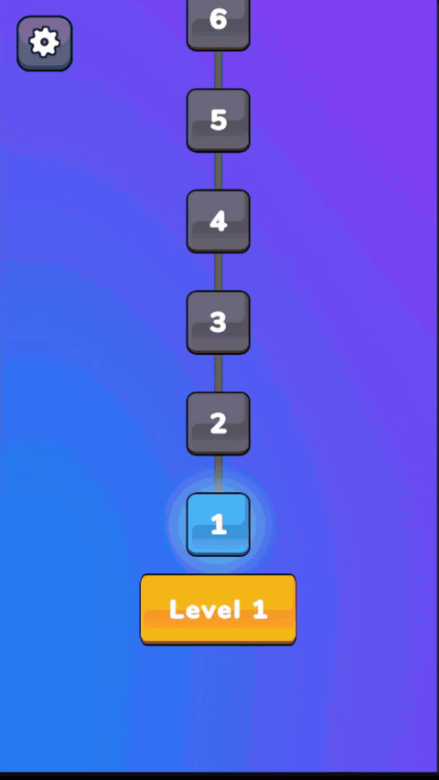
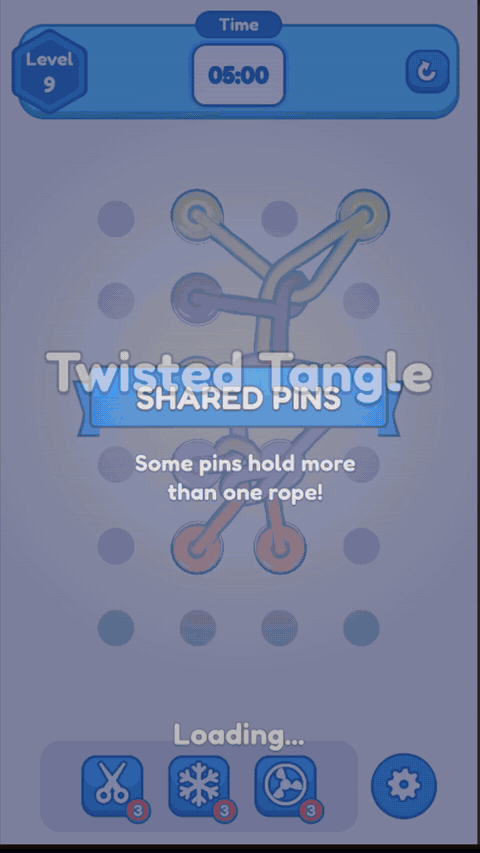
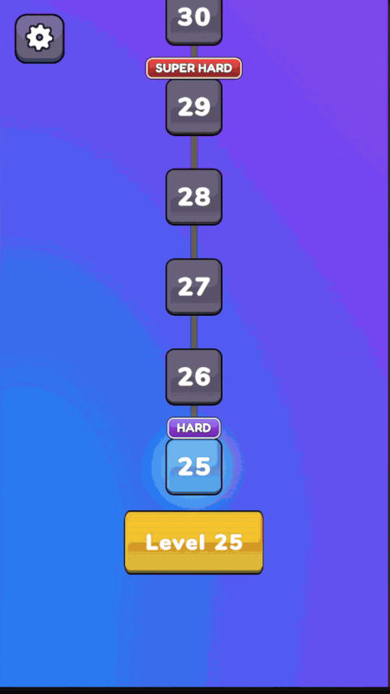
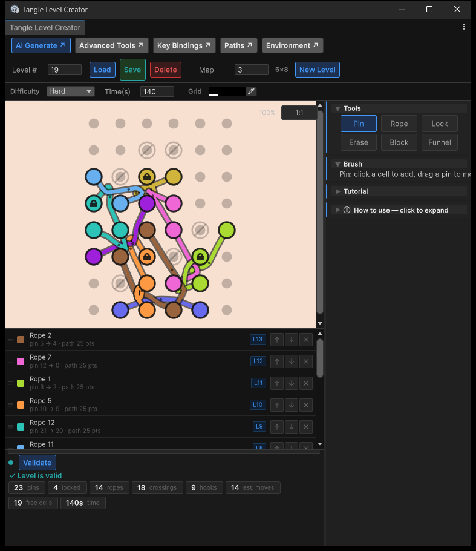
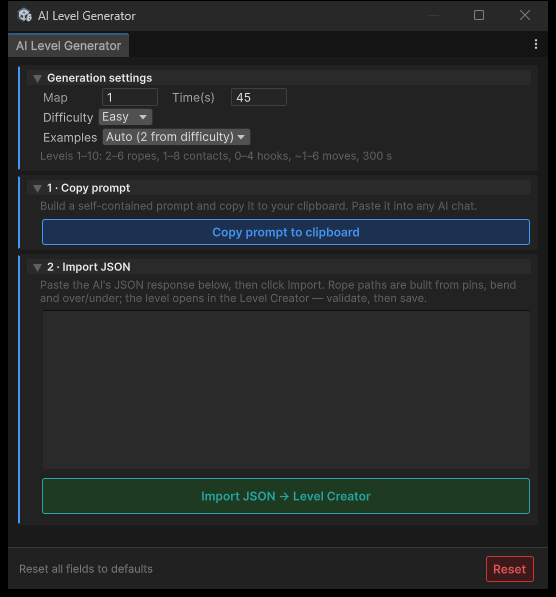

<h1>Twisted Tangle</h1>

<h2>Gameplay</h2>

<table>
  <tr>
    <td align="center"><b>Easy</b><br/>Menu, tutorial, win</td>
    <td align="center"><b>Medium</b><br/>New obstacle intro, scissors</td>
    <td align="center"><b>Hard</b><br/>Hard level, untangle, shuffle</td>
  </tr>
  <tr>
    <td></td>
    <td></td>
    <td></td>
  </tr>
</table>

<br/>

<a href="Twisted_Tangle_Screenshots/index.md"><b>All Screenshots & Raw Videos (60 fps)</b></a>

<h2>Level Editor</h2>

<table>
  <tr>
    <td align="center"><b>Level Creator</b><br/>Pins, ropes, locks, holes, funnels, validation</td>
  </tr>
  <tr>
    <td></td>
  </tr>
</table>

<br/>

<h2>AI Level Integration</h2>

New levels can be designed by any AI chat (Claude, ChatGPT, Gemini). The editor writes the prompt for you and turns the answer into a playable level.

<details>
<summary><b>How to generate a level with AI</b></summary>
<br/>



1. **Open the generator:** `TwistedTangle > AI Level Generator`, or the **AI Generate** button in the Level Creator.
2. **Choose the level:**
   - **Map:** board size, grid = (3+N) x (5+N).
   - **Difficulty:** Easy, Medium or Hard.
   - **Time(s):** time limit; 0 uses the usual time of that difficulty.
   - **Examples:** Auto adds 2 existing levels of the same difficulty as a style guide.
3. **Copy the prompt:** click **Copy prompt to clipboard**.
4. **Ask the AI:** paste the prompt into the AI chat and send it. It answers with one JSON block.
5. **Import:** paste that JSON into the generator and click **Import JSON → Level Creator**.
6. **Check and save:** in the Level Creator click **Validate**. When it is green, click **Save**.

</details>

<details>
<summary><b>What happens under the hood</b></summary>
<br/>

- The prompt contains the game rules and target numbers (ropes, pins, crossings, moves) measured from the shipped levels of the chosen difficulty.
- The AI only places pins and decides which rope goes over which. It does not draw ropes.
- The editor builds the rope paths from that data.
- The validator uses the same rules as the game: every rope must start tangled, and it estimates how many moves the level needs.
- No API key is needed; nothing is sent from Unity.

</details>

<h2>Tech Stack</h2>

- **Engine:** Unity 6000.0.64f1, URP
- **Rope physics:** Obi Rope
- **DI:** Reflex
- **Animation:** DOTween
- **Async:** UniTask
- **Save:** Easy Save 3 + ES3 Key Manager
- **Shaders:** Toony Colors Pro, custom rope outline shader
- **UI:** uGUI + TextMesh Pro

<h2>Getting Started</h2>

1. Clone with the submodule (ES3 Key Manager lives in `Packages/`):

   ```bash
   git clone --recurse-submodules https://github.com/huseyinbaglayici/Twisted_Tangle_Clone.git
   ```

   Already cloned without it? Run `git submodule update --init`.
2. Open the folder with **Unity 6000.0.64f1** from Unity Hub (Git must be installed, some packages are pulled from Git).
3. Open `Assets/Scenes/Boostrap.unity` and press **Play**.
4. Editor tools are under the **TwistedTangle** menu (Level Creation Tool, AI Level Generator, ...).
