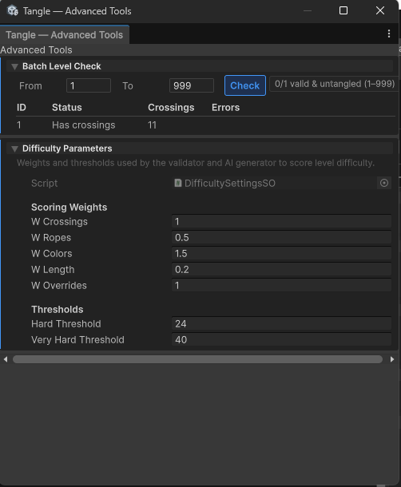
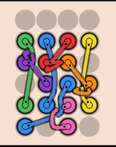
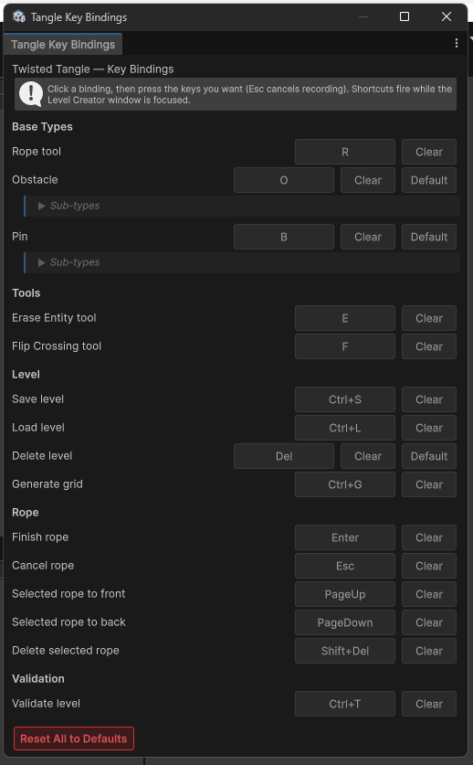
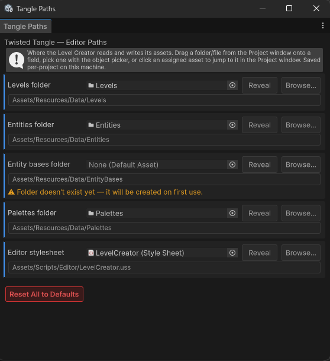

# Screenshots & Videos

## Editor Screenshots

<b>Level Creator — General</b>

 

<b>Advanced Tools</b>

 

<b>AI Level Generator</b>

 

<b>Environment Settings</b>

 

<b>Grid Output</b>

 

<b>Key Bindings</b>

 

<b>Editor Paths</b>

 

## Gameplay Videos

Source recordings of the README GIFs, 1080x1920 at 60 fps.

<b>Easy — Menu, tutorial, win</b>

 
<a href="Videos/Gameplay-Easy.mp4?raw=true">Gameplay-Easy.mp4</a> (8 s)

<b>Medium — New obstacle intro, scissors</b>

 
<a href="Videos/Gameplay-Medium.mp4?raw=true">Gameplay-Medium.mp4</a> (10 s)

<b>Hard — Hard level, untangle, shuffle</b>

 
<a href="Videos/Gameplay-Hard.mp4?raw=true">Gameplay-Hard.mp4</a> (23 s)

